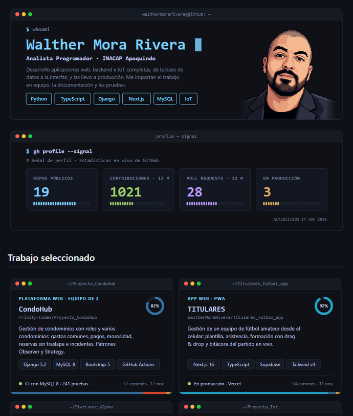
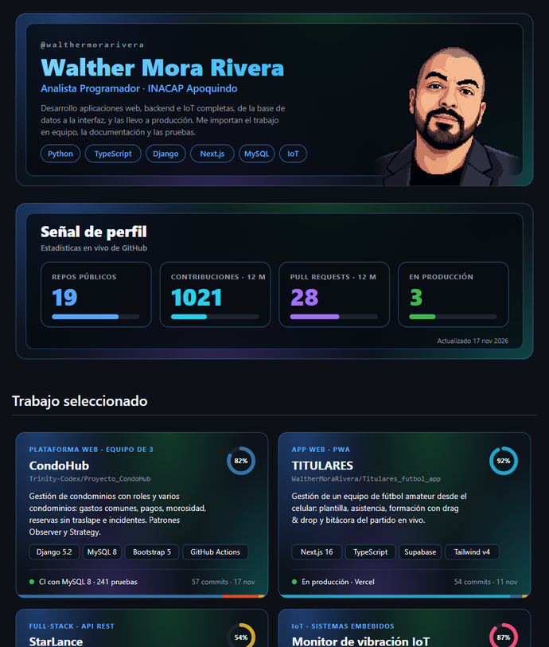
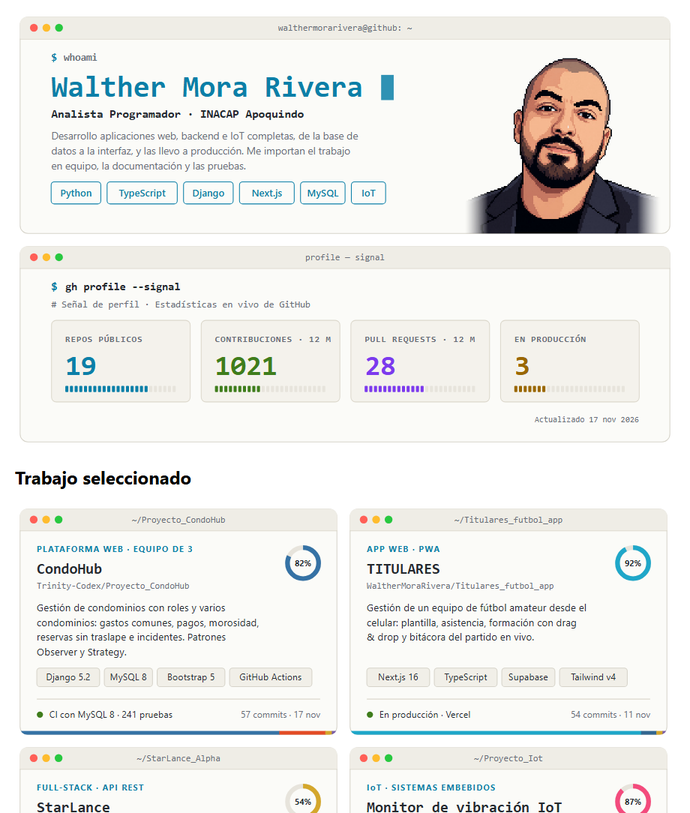
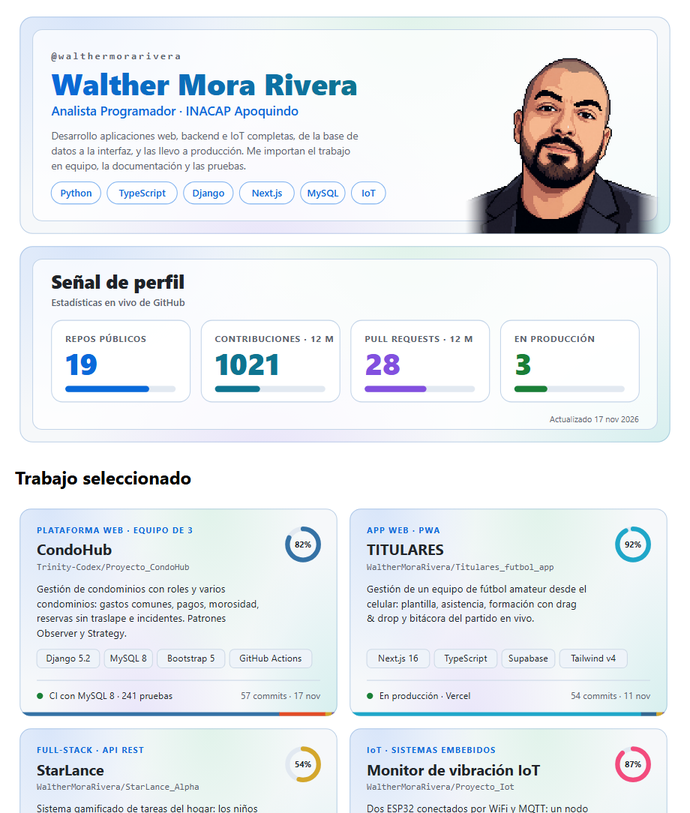

# Generador de README para perfiles de GitHub

[English](README.md) · **Español**

Genera un README de perfil de GitHub pulido a partir de tus datos reales de GitHub: tarjetas SVG
con estadísticas en vivo, temas claro y oscuro, y una **cabecera animada** opcional hecha con tu
propia imagen o GIF. Un agente de Claude Code te hace algunas preguntas de diseño, arma una vista
previa y publica cuando lo apruebas. ¿No usas Claude? El generador es un solo script de Python sin
dependencias.

[](LICENSE)


## Ejemplos en vivo

<a href="https://github.com/WaltherMoraRivera"></a>

[github.com/WaltherMoraRivera](https://github.com/WaltherMoraRivera): tema terminal, en español, retrato pixel art animado.

<a href="https://github.com/Rixmerz"></a>

[github.com/Rixmerz](https://github.com/Rixmerz): tema terminal, en inglés. Pixel art de la cabecera por Hal4822.

## Dos estilos

| Terminal | Glass |
|---|---|
|  |  |
|  |  |

Cada tarjeta sigue sola el tema de GitHub de quien la mira.

## Qué incluye

- **Cabecera**: nombre, rol, bio y etiquetas, y a la derecha un GIF animado, una imagen fija, un
  panel estilo neofetch o nada.
- **Señal de perfil**: cuatro estadísticas en vivo a elección (repos, contribuciones, pull
  requests, estrellas, seguidores, proyectos en producción).
- **Trabajo seleccionado**: cuatro tarjetas de proyecto con descripción, stack, estado, commits,
  último push y reparto de lenguajes.
- **Stack de lenguajes** por bytes de código y tus **herramientas** agrupadas por área.
- **Mapa de contribuciones** de las últimas 52 semanas, con semanas activas y racha más larga.
- Inglés o español, `README.md` generado desde un solo `profile.json` y un workflow semanal
  opcional para actualizar las cifras.

## Inicio rápido con Claude Code

```text
/plugin marketplace add WaltherMoraRivera/github-profile-readme-generator
/plugin install github-profile@github-profile-readme-generator
```

Luego basta con decir **"configura mi perfil de GitHub"**. El agente:

1. Revisa `gh`, Python y git, y lee tus datos públicos de GitHub.
2. Pregunta el estilo (terminal o glass), el color de acento, el idioma y qué va en la cabecera.
3. Propone tus cuatro mejores proyectos, las estadísticas y todos los textos, y te pide confirmarlos.
4. Convierte tu GIF o imagen en una cabecera que funciona en ambos temas.
5. Arma una vista previa local y publica solo lo que apruebes.

## Inicio rápido sin Claude

Necesitas Python 3.9+ y la [CLI de GitHub](https://cli.github.com) con sesión iniciada (`gh auth login`).

```bash
git clone https://github.com/WaltherMoraRivera/github-profile-readme-generator
gh repo create <tu-usuario>/<tu-usuario> --public --clone     # o clónalo si ya existe
cd <tu-usuario>
mkdir -p scripts data
cp ../github-profile-readme-generator/plugin/skills/github-profile/scripts/generate.py scripts/
cp ../github-profile-readme-generator/plugin/skills/github-profile/templates/profile.example.json data/profile.json
cp ../github-profile-readme-generator/plugin/skills/github-profile/templates/gitignore .gitignore
# edita data/profile.json y luego:
python3 scripts/generate.py
```

Abre `preview.html` para revisarlo y luego haz commit y push de `README.md assets data scripts .gitignore`.
GitHub muestra en tu perfil el README de un repositorio público con el mismo nombre que tu cuenta.

Todas las opciones están en
[`configuration.md`](plugin/skills/github-profile/reference/configuration.md) (en inglés).

### Cabecera animada desde un GIF

Requiere Pillow (`python3 -m pip install --user pillow`).

```bash
python3 plugin/skills/github-profile/scripts/frames.py mi.gif data/portrait-sheet.png --bg white --native auto --height 450
```

- `--bg`: el fondo sólido de tu GIF (`white`, `black`), o `none` si ya es transparente.
- `--native auto`: detecta pixel art ampliado y lo mantiene nítido. Un retrato de 21 fotogramas
  quedó en menos de 100 KB.
- `--fade-sides 0.12 --colors 0`: suaviza una figura cortada por los bordes laterales.

Luego, en `profile.json`: `"portrait": "data/portrait-sheet.png"`,
`"portrait_frames": "data/portrait-sheet.json"`, `"portrait_width": 250`.

Para una imagen fija con fondo oscuro sólido, `scripts/cutout.py` quita el fondo.

## Cómo funciona

- `generate.py` consulta las API REST y GraphQL de GitHub con tu sesión de `gh` y escribe archivos
  SVG simples. Nada queda alojado en servicios externos, así que nada puede caerse.
- GitHub muestra las imágenes del README como ``. Dentro de un SVG el CSS sigue funcionando, así
  que cada tarjeta lleva colores `prefers-color-scheme` para ambos temas, y la animación de la
  cabecera es una hoja de sprites CSS que avanza un fotograma a la vez. Se detiene para quien
  prefiere movimiento reducido.
- El texto en SVG no hace saltos de línea, así que el generador lo corta según un ancho estimado,
  con margen de seguridad.

## Bueno saber

- **Repos fijados**: solo los puedes fijar tú en tu perfil ("Customize your pins"); GitHub no
  tiene API para eso.
- **Trabajo privado**: aparece en el mapa solo si activas "Include private contributions on my
  profile" en tu configuración.
- **Actualización semanal**: `templates/update-profile.yml` solo corre si el repo tiene el secreto
  `PROFILE_TOKEN`, un token de solo lectura que creas tú. El token por defecto de Actions solo ve la
  actividad pública y bajaría tus cifras. Sin él, actualiza ejecutando el generador y haciendo push.
- **¿Imágenes viejas después de un push?** GitHub las guarda en caché unos minutos; recarga con Ctrl+F5.
- **Arte de otra persona**: requiere un crédito visible (`credits` en `profile.json`).

Errores conocidos y cómo se resolvieron:
[`lessons.md`](plugin/skills/github-profile/reference/lessons.md) (en inglés).

## Estructura del repositorio

```
.claude-plugin/marketplace.json          marketplace de Claude Code
plugin/.claude-plugin/plugin.json        manifiesto del plugin
plugin/skills/github-profile/
├── SKILL.md                             flujo del agente y preguntas de configuración
├── scripts/generate.py                  generador (solo biblioteca estándar)
├── scripts/frames.py                    GIF → hoja de sprites animada (Pillow)
├── scripts/cutout.py                    quita un fondo oscuro (Pillow + numpy)
├── templates/                           profile.example.json, workflow, .gitignore
└── reference/                           configuración, lecciones, capturas de estilos
```

## Licencia

[MIT](LICENSE) © 2026 Walther Mora Rivera. Hecho con Claude Code.
