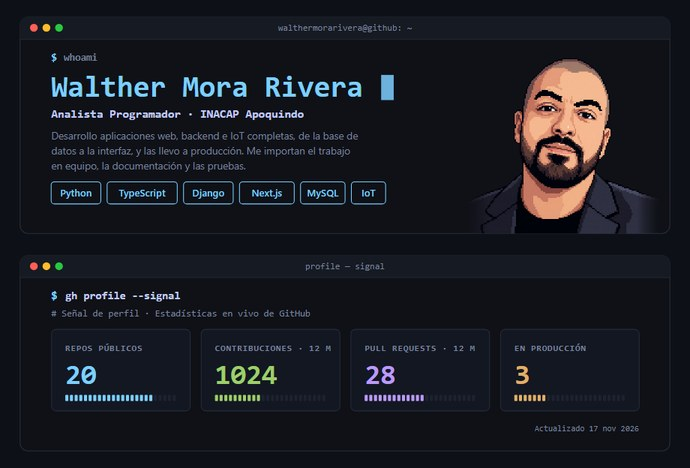
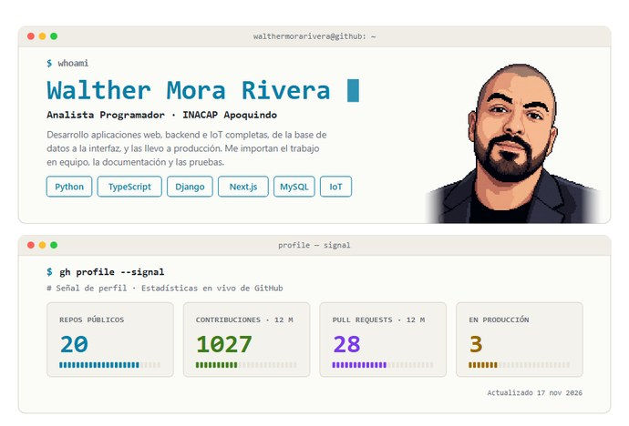
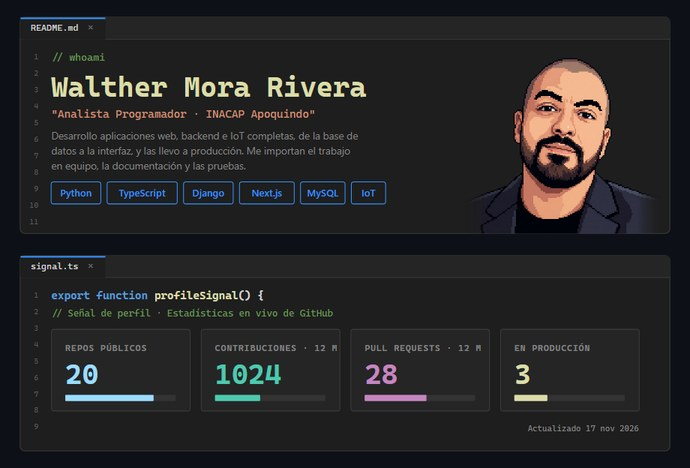
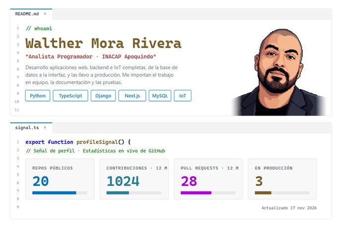
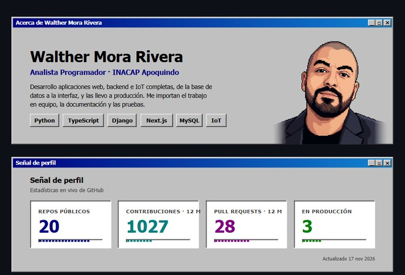
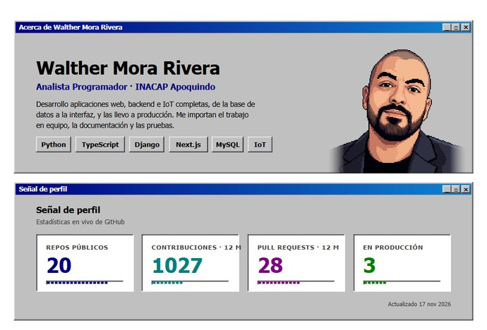
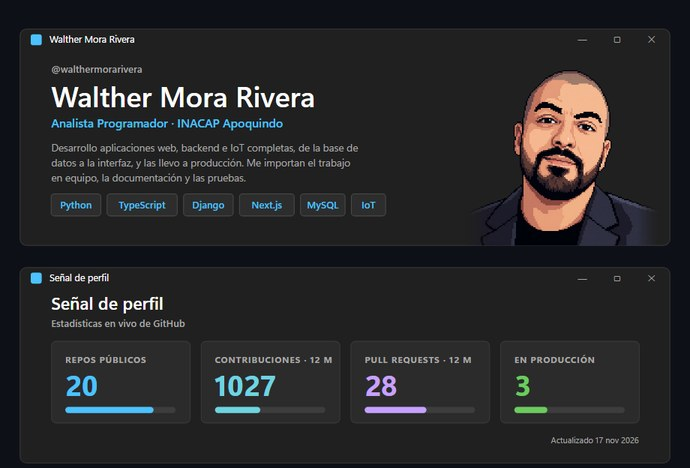
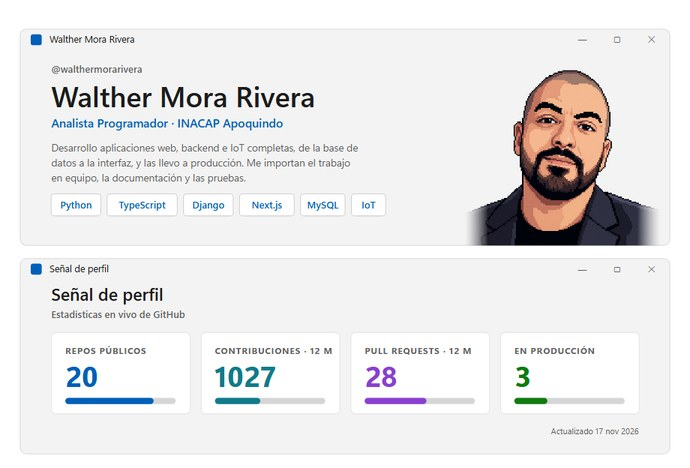
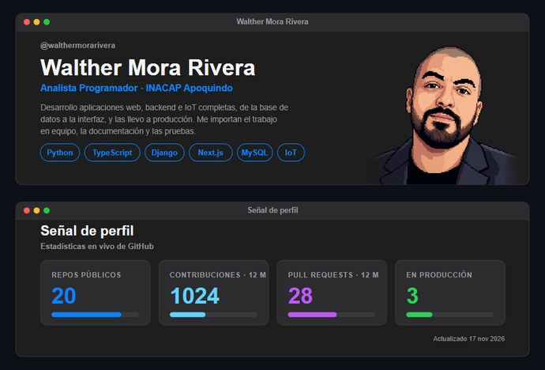
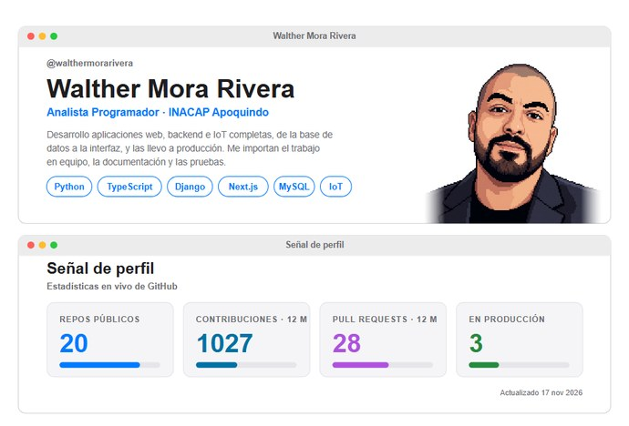

# GitHub Profile README Generator

**English** · [Español](README.es.md)

Generate a polished GitHub profile README from your real GitHub data: SVG cards with live stats,
five themes inspired by the tools developers use every day, light and dark modes, and an optional **animated header** made from your own image or GIF. A
Claude Code agent asks you a few design questions, builds a preview and publishes it when you
approve. No Claude? The generator is a single Python script with no dependencies.

[](LICENSE)


## Live example

<a href="https://github.com/WaltherMoraRivera"></a>

[github.com/WaltherMoraRivera](https://github.com/WaltherMoraRivera): terminal theme, Spanish, animated pixel-art portrait.

## Five themes, inspired by the tools you use every day

| Theme | Dark | Light |
|---|---|---|
| **terminal** · shell prompts, one accent, Linux distro variants |  |  |
| **editor** · tabs, line numbers, your data written as code |  |  |
| **classic** · 90s desktop windows and block progress bars |  |  |
| **win11** · flat rounded windows, caption buttons |  |  |
| **macos** · traffic lights, unified title bar |  |  |

Every card follows the viewer's GitHub theme on its own. The terminal theme also comes in Linux
distribution variants (`ubuntu`, `arch`, `debian`, `fedora`, `mint`, `cachyos`): their color, and
`you@archlinux: ~` in the title bar. Themes are inspired by these systems and use no logos.

## What you get

- **Header**: name, role, bio and tags, plus an animated GIF, a still image, a neofetch-style
  panel or nothing on the right.
- **Profile signal**: four live stats of your choice (repos, contributions, pull requests, stars,
  followers, projects in production).
- **Selected work**: four project cards with description, stack, status, commit count, last push
  and language split.
- **Language stack** by bytes of code, and your **toolkit** grouped by area.
- **Contribution heatmap** for the last 52 weeks, with active weeks and longest streak.
- English or Spanish, `README.md` generated from one `profile.json`, and an optional weekly
  refresh workflow.

## Quick start with Claude Code

```text
/plugin marketplace add WaltherMoraRivera/github-profile-readme-generator
/plugin install github-profile@github-profile-readme-generator
```

Then just say **"set up my GitHub profile"**. The agent:

1. Checks `gh`, Python and git, and reads your public GitHub data.
2. Asks about style (five themes, including Linux distro variants), language and header media.
3. Proposes your four best projects, the stats to show and every text, and asks you to confirm.
4. Turns your GIF or image into a header that works in both themes.
5. Builds a local preview and publishes only what you approve.

## Quick start without Claude

You need Python 3.9+ and the [GitHub CLI](https://cli.github.com) signed in (`gh auth login`).

```bash
git clone https://github.com/WaltherMoraRivera/github-profile-readme-generator
gh repo create <you>/<you> --public --clone     # or clone it if it already exists
cd <you>
mkdir -p scripts data
cp ../github-profile-readme-generator/plugin/skills/github-profile/scripts/generate.py scripts/
cp ../github-profile-readme-generator/plugin/skills/github-profile/templates/profile.example.json data/profile.json
cp ../github-profile-readme-generator/plugin/skills/github-profile/templates/gitignore .gitignore
# edit data/profile.json, then:
python3 scripts/generate.py
```

Open `preview.html` to check it, then commit and push `README.md assets data scripts .gitignore`.
A public repository named exactly like your account is shown on your profile page.

Every option is documented in
[`configuration.md`](plugin/skills/github-profile/reference/configuration.md).

### Animated header from a GIF

Needs Pillow (`python3 -m pip install --user pillow`).

```bash
python3 plugin/skills/github-profile/scripts/frames.py my.gif data/portrait-sheet.png --bg white --native auto --height 450
```

- `--bg`: your GIF's solid background (`white`, `black`), or `none` if it is already transparent.
- `--native auto`: detects upscaled pixel art and keeps it sharp. A 21-frame portrait came out at
  under 100 KB.
- `--fade-sides 0.12 --colors 0`: softens a figure cut by the left and right edges.

Then set in `profile.json`: `"portrait": "data/portrait-sheet.png"`,
`"portrait_frames": "data/portrait-sheet.json"`, `"portrait_width": 250`.

For a still image on a solid dark background, `scripts/cutout.py` removes the background.

## How it works

- `generate.py` calls the GitHub REST and GraphQL APIs through your `gh` login and writes plain SVG
  files. Nothing is hosted elsewhere, so nothing can go down.
- GitHub shows README images as ``. Inside an SVG, CSS still works there, so each card carries
  `prefers-color-scheme` colors for both themes, and the header animation is a CSS sprite sheet
  that steps one frame at a time. It stops for viewers who prefer reduced motion.
- Text in SVG does not wrap, so the generator wraps it by estimated width, on the safe side.

## Good to know

- **Pinned repositories** can only be set by you on your profile ("Customize your pins"); GitHub has
  no API for it.
- **Private work** shows in the heatmap only if you enable "Include private contributions on my
  profile" in your settings.
- **Weekly refresh**: `templates/update-profile.yml` runs only when the repo has a `PROFILE_TOKEN`
  secret, a read-only token you create. The default Actions token sees public activity only and
  would lower your numbers. Without it, refresh by running the generator and pushing.
- **Images look old after a push?** GitHub caches them for a few minutes; reload with Ctrl+F5.
- **Art by someone else** needs a visible credit (`credits` in `profile.json`).

Known pitfalls and how they were solved:
[`lessons.md`](plugin/skills/github-profile/reference/lessons.md).

## Repository layout

```
.claude-plugin/marketplace.json          Claude Code marketplace
plugin/.claude-plugin/plugin.json        plugin manifest
plugin/skills/github-profile/
├── SKILL.md                             the agent's workflow and configuration questions
├── scripts/generate.py                  generator (standard library only)
├── scripts/frames.py                    GIF → animated sprite sheet (Pillow)
├── scripts/cutout.py                    removes a dark background (Pillow + numpy)
├── templates/                           profile.example.json, workflow, .gitignore
└── reference/                           configuration, lessons, style screenshots
```

## License

[MIT](LICENSE) © 2026 Walther Mora Rivera. Built with Claude Code.
